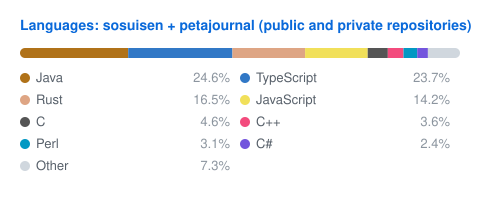

The languages card includes non-fork repositories owned by sosuisen and the
organizations listed in `GH_ORGS` in `.github/workflows/languages.yml`.
`SKIPPED_REPOS` excludes matching repository names across all owners. The
workflow includes public repositories only; enabling `INCLUDE_PRIVATE` requires
a token with access to the private repositories, including organization access.
The card title reflects the configured owners and repository visibility.
